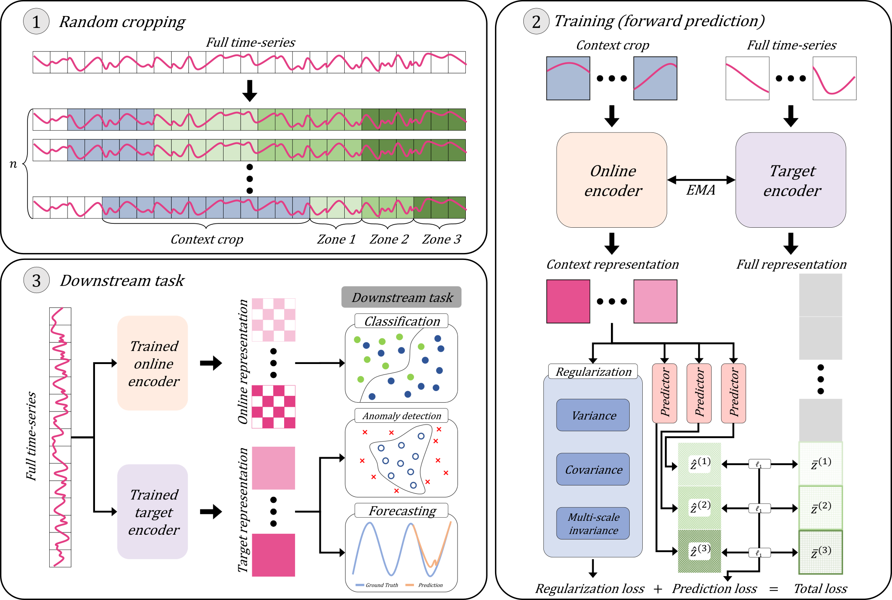

# CF-JEPA

Official code of **CF-JEPA** (crop-based forward JEPA), a mask-free joint-embedding predictive architecture for
time-series self-supervised learning, with the benchmark that compares it with 10 published methods under one
protocol for classification, forecasting, and anomaly detection.

> Paper: *CF-JEPA: Mask-free forward prediction with asymmetric encoder utilization for time-series representation
> learning*, Knowledge-Based Systems 355 (2027) 117305. https://doi.org/10.1016/j.knosys.2026.117305

<p align="center">
  
</p>

## Model

Masking is replaced by multi-horizon forward prediction: random crops are the context, and short-, mid-, and
long-horizon futures are the targets.

```
random crop   -> online encoder (multi-scale DWConv) -> three zone-conditional predictors (short / mid / long)
whole series  -> EMA target encoder (stop-grad)      -> latents of the three future zones = targets
```

The online encoder is used for classification and the EMA target encoder for forecasting and anomaly detection,
from the same pretraining run. The predictor loss weight decays from 1 to 0 over training (horizon annealing).
Code: `baselines/cf_jepa/` (no upstream dependency); tuned settings (e.g. `lr=0.000225` for `D=320`) are the
trainer's `DEFAULT_PARAMS`.

## Compared methods

| Method | Venue | Family |
|---|---|---|
| TS2Vec | AAAI 2022 | Contrastive |
| CoST | ICLR 2022 | Contrastive (frequency) |
| InfoTS | ICML 2023 | Contrastive |
| SimMTM | NeurIPS 2023 | Reconstructive |
| T-Rep | NeurIPS 2023 | Non-contrastive |
| SoftCLT | ICLR 2024 | Contrastive (soft) |
| AutoTCL | ICLR 2024 | Contrastive |
| TimesURL | AAAI 2024 | Contrastive |
| TS-JEPA | arXiv 2025 | JEPA |
| FEI | AAAI 2025 | JEPA (frequency) |

## Repository

```
run_classification.py   entry points (dispatch to torchrun); --check shows progress
run_forecast.py
run_anomaly.py
scripts/benchmarks/     workers for classification, forecasting, anomaly detection
baselines/              CF-JEPA and wrappers of the compared methods (upstream cloned by setup_baselines.sh)
utils/                  data loading, runner, anomaly scoring and metrics
splits/                 dataset subset files (fast to slow)
tests/                  unit tests: python -m unittest discover -s tests (no GPU)
config.py               data paths
```

Each method has a trainer with `fit(train_data, epochs, verbose, callback)` and `encode(data, raw=False)`
(`raw=True`: `(B, T, D)` before pooling, `raw=False`: `(B, D)`). `baselines.get_trainer(method, input_dims, **kwargs)`
builds it; upstream code is isolated by `baselines/_import_helper.py`.

## Installation

```bash
git clone https://github.com/WDSLab/CF-JEPA.git
cd CF-JEPA
bash setup_baselines.sh   # clones the compared methods and runs pip install -r requirements.txt
```

## Data

Placed under `data/` (paths in `config.py`):

| Variable | Default path | Contents |
|---|---|---|
| `UCR_PATH` | `data/UCR/` | UCR archive (univariate) |
| `UEA_PATH` | `data/UEA/` | UEA archive (multivariate, ARFF) |
| `FORECAST_PATH` | `data/forecast/` | ETTh1/2, ETTm1/2, weather, AirQuality, SML, Traffic CSVs |
| `ANOMALY_PATH` | `data/anomaly/` | KPI, Yahoo pickles (univariate) + SMD/, MSL/, SMAP/, PSM/ (multivariate, Anomaly-Transformer preprocessing) |

## Experiments

| Setting | Value |
|---|---|
| Epochs | 200 (checkpoints at 50, 100, 200 for classification and anomaly detection; 50, 100, 200, 400 for forecasting) |
| Batch size | 16 |
| Learning rate, hidden / representation sizes | each method's paper values |
| Seeds | 3 (42, 43, 44) |
| Classification | SVM (RBF) + SVM (linear), max pooling + adaptive average pooling |
| Forecasting | ridge regression on causal representations |
| Anomaly detection | k-NN and Gaussian scoring; delay-adjusted F1 with a threshold from training statistics (mean + 4σ); delay 7 for KPI and the multivariate sets, 3 for Yahoo; no point adjustment |

Epochs are fixed rather than iterations, so every method sees the whole training set the same number of times.

```bash
# classification
python run_classification.py --method cf_jepa --datasets_file splits/datasets_ucr_t1.txt --iterations 1   # one seed
python run_classification.py --datasets_file splits/datasets_ucr_t1.txt --ngpu 2                         # all methods, 3 seeds

# forecasting
python run_forecast.py --method cf_jepa --datasets ETTh1 ETTh2 ETTm1 ETTm2

# anomaly detection
python run_anomaly.py --method cf_jepa --scoring knn     # univariate (KPI, Yahoo)
python run_anomaly.py --multivariate --ngpu 2            # SMD, MSL, SMAP, PSM; one run scores k-NN and Gaussian
python run_anomaly.py --all --ngpu 2                     # both

# progress
python run_classification.py --check
```

Results go to `results/{cls,fcst,ano}_results.csv` (multivariate anomaly detection: `results/ano_mv_results.csv`, one
row per protocol; the paper uses `delay_train4sigma`). Runs resume: a (method, dataset, seed, epoch) row already
present is skipped.

With `--ngpu`, datasets are shared out through `torchrun` (Gloo): each GPU takes the next dataset from a file-locked
counter. Anomaly detection runs one dataset per call and splits its seeds across GPUs. A failed job does not stop the
others; the run exits with code 1 and lists the failed jobs.

## License

MIT (`LICENSE`). The compared methods cloned into `baselines/` keep their own licenses.

## Citation

```bibtex
@article{lee2027cfjepa,
  title={CF-JEPA: Mask-free forward prediction with asymmetric encoder utilization for time-series representation learning},
  author={Lee, Jaehoon and Sim, Sunghyun},
  journal={Knowledge-Based Systems},
  volume={355},
  pages={117305},
  year={2027},
  doi={10.1016/j.knosys.2026.117305}
}
```

## Acknowledgements

Code of the compared methods:
[TS2Vec](https://github.com/zhihanyue/ts2vec),
[T-Rep](https://github.com/Let-it-Care/T-Rep),
[AutoTCL](https://github.com/AslanDing/AutoTCL),
[SoftCLT](https://github.com/seunghan96/softclt),
[TimesURL](https://github.com/Alrash/TimesURL),
[InfoTS](https://github.com/chengw07/InfoTS),
[CoST](https://github.com/salesforce/CoST),
[SimMTM](https://github.com/thuml/SimMTM),
[TS-JEPA](https://github.com/Sennadir/TS_JEPA),
[FEI](https://github.com/USTBInnovationPark/Frequency-masked-Embedding-Inference).
