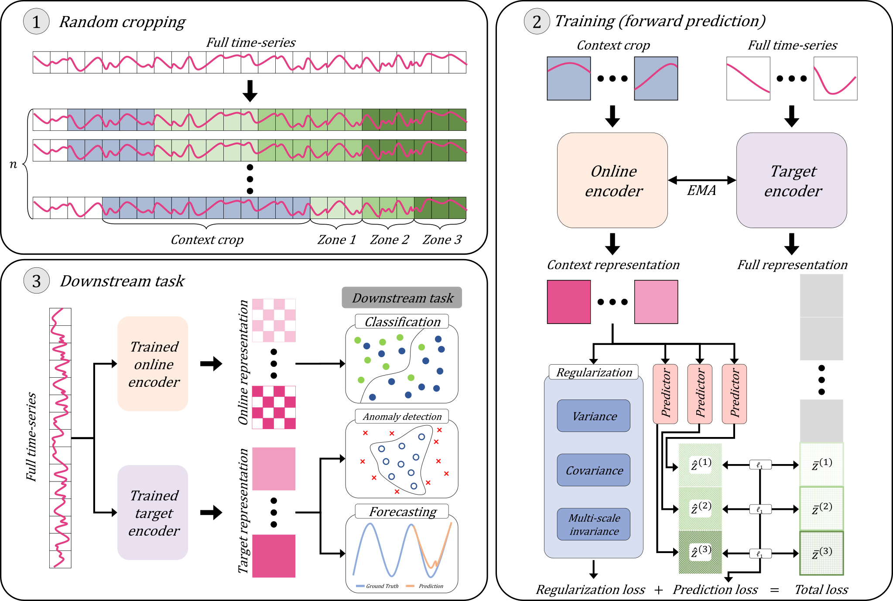

# CF-JEPA

Official implementation of **CF-JEPA** (crop-based forward JEPA), a mask-free joint-embedding predictive architecture for time-series self-supervised learning, together with a unified benchmarking framework that re-evaluates 10 published baselines under a single fair-comparison protocol across **classification**, **forecasting**, and **anomaly detection**.

> Paper: _CF-JEPA: Mask-free forward prediction with asymmetric encoder utilization for time-series representation learning_ (under review).

<p align="center">
  
</p>

## Abstract

**CF-JEPA** is a mask-free joint-embedding predictive architecture for time series. It replaces masking with **multi-horizon forward prediction** — random crops as context, short/mid/long-horizon futures as targets — directly using the temporal ordering of time series as the learning signal. We also exploit a strong online vs. EMA-target asymmetry (online → classification, EMA target → forecasting/anomaly) to cut multivariate forecasting MSE by 27% without an additional pretraining run.

## Baselines

| Method | Venue | Family |
|---|---|---|
| TS2Vec | AAAI 2022 | Contrastive |
| CoST | ICLR 2022 | Contrastive (frequency) |
| InfoTS | ICML 2023 | Contrastive |
| SimMTM | NeurIPS 2023 | Reconstructive |
| T-Rep | NeurIPS 2023 | Non-contrastive |
| SoftCLT | ICLR 2024 | Contrastive (soft) |
| AutoTCL | ICLR 2024 | Contrastive |
| TimesURL | AAAI 2024 | Contrastive |
| TS-JEPA | arXiv 2025 | JEPA |
| FEI | AAAI 2025 | JEPA (frequency) |
| **CF-JEPA (ours)** | — | JEPA |

## Setup

```bash
# 1. Clone this repo
git clone https://github.com/WDSLab/CF-JEPA.git
cd CF-JEPA

# 2. Clone baseline upstream repos + install dependencies
bash setup_baselines.sh
```

Place datasets under `data/` (paths configurable in `config.py`):

| Variable | Default path | Contents |
|---|---|---|
| `UCR_PATH` | `data/UCR/` | UCR archive (univariate) |
| `UEA_PATH` | `data/UEA/` | UEA archive (multivariate, ARFF) |
| `FORECAST_PATH` | `data/forecast/` | ETTh1/2, ETTm1/2, weather, AirQuality, SML, Traffic CSVs |
| `ANOMALY_PATH` | `data/anomaly/` | KPI, Yahoo pickles (univariate) + SMD/, MSL/, SMAP/, PSM/ (multivariate, Anomaly-Transformer preprocessing) |

## Quick start

### Classification (UCR + UEA)

```bash
# Single method, single seed (fast verify, ~few minutes)
python run_classification.py --method cf_jepa --datasets_file splits/datasets_ucr_t1.txt --iterations 1

# All methods on a fast subset (3 seeds = paper default)
python run_classification.py --datasets_file splits/datasets_ucr_t1.txt --ngpu 2
```

### Forecasting

```bash
python run_forecast.py --method cf_jepa --datasets ETTh1 ETTh2 ETTm1 ETTm2
```

### Anomaly Detection

```bash
# Univariate (KPI, Yahoo) — delay-adjusted F1, mean+4sigma threshold
python run_anomaly.py --method cf_jepa --scoring knn

# Multivariate (SMD, MSL, SMAP, PSM) — same protocol (delay 7); one training scores both k-NN and Gaussian
python run_anomaly.py --multivariate --ngpu 2

# Both
python run_anomaly.py --all --ngpu 2
```

### Status

```bash
python run_classification.py --check   # CSV-level progress
python run_forecast.py --check
python run_anomaly.py --check
```

Each run writes to `results/{cls,fcst,ano}_results.csv` (multivariate anomaly detection: `results/ano_mv_results.csv`, one row per evaluation protocol; the paper uses `delay_train4sigma`). Resume logic skips any (method, dataset, seed, epoch) tuple already present.

## Architecture

Each baseline lives in its own subdirectory under `baselines/`, exposing a unified trainer interface:

- `fit(train_data, epochs, verbose, callback)` — train the encoder
- `encode(data, raw=False)` — produce representations; `raw=True` returns pre-pooling `(B, T, D)`, `raw=False` returns post-pooling `(B, D)`

The factory `baselines.get_trainer(method, input_dims, **kwargs)` instantiates the right wrapper. Original upstream code is cloned into each subdirectory by `setup_baselines.sh` and isolated via `baselines/_import_helper.py`.

**CF-JEPA** is self-contained in `baselines/cf_jepa/` with no upstream dependency: three zone-conditional predictors on a multi-scale DWConv encoder, with horizon annealing. Tuned hyperparameters (e.g. `lr=0.000225` for `D=320`) are baked into the trainer's `DEFAULT_PARAMS` for reproducibility.


## Fair-comparison protocol

| Setting | Value |
|---|---|
| Epochs | 200 (checkpoints at 50, 100, 200 for cls/anomaly; 50, 100, 200, 400 for fcst) |
| Batch size | 16 (fixed) |
| Learning rate | Each method's original paper value |
| Hidden / repr dims | Each method's original paper value |
| Seeds | 3 (42, 43, 44) |
| Cls eval | SVM (RBF) + SVM (Linear), maxpool + adaptive_avg pool |
| Fcst eval | Ridge regression on causal representations |
| Anomaly eval | k-NN + Gaussian scoring (`--scoring knn`, `--scoring gaussian`); delay-adjusted F1 with a training-statistics threshold (mean + 4σ) for both univariate (delay 7 for KPI, 3 for Yahoo) and multivariate (delay 7) benchmarks; point adjustment is not used |

We fix **epochs** rather than iterations so all methods see the entire training set the same number of times, regardless of dataset size.

## Multi-GPU

Dataset-parallel via `torchrun` with dynamic queue distribution: each GPU grabs the next available dataset via a file-locked counter (`fcntl` on Linux, `msvcrt` on Windows; not a static split). Backend: Gloo. Anomaly detection runs one dataset per call and splits its seeds across GPUs instead. If a job fails, the runner continues with the remaining jobs and exits with code 1 at the end; the launchers list the failed jobs.

```bash
python run_classification.py --ngpu 4 --datasets_file splits/datasets_ucr_t1.txt
```

## Repository layout

```
CF-JEPA/
├── baselines/              # 10 baseline wrappers + CF-JEPA
│   ├── ts2vec/             # each has trainer.py; upstream cloned by setup_baselines.sh
│   ├── softclt/
│   ├── ... (8 more)
│   └── cf_jepa/            # self-contained: encoder, predictor, losses, trainer
├── scripts/
│   └── benchmarks/         # paper main entry points (cls / fcst / ano)
├── utils/                  # data loaders, runner plumbing, anomaly scoring/metrics
├── tests/                  # unit tests: python -m unittest discover -s tests (no GPU)
├── splits/                 # dataset subset files (fast → slow ordering)
├── config.py               # data root paths
├── run_classification.py   # user-facing wrappers (dispatch via torchrun)
├── run_forecast.py
├── run_anomaly.py
├── run_*.sh                # thin bash wrappers around the three above
└── setup_baselines.sh
```

## License

MIT — see [LICENSE](LICENSE).

## Citation

```bibtex
@article{lee2026cfjepa,
  title={CF-JEPA: Mask-free forward prediction with asymmetric encoder utilization for time-series representation learning},
  author={Lee, Jaehoon and Sim, Sunghyun},
  journal={Under review},
  year={2026}
}
```

## Acknowledgements

We thank the authors of the 10 baseline methods for releasing their code:
[TS2Vec](https://github.com/zhihanyue/ts2vec),
[T-Rep](https://github.com/Let-it-Care/T-Rep),
[AutoTCL](https://github.com/AslanDing/AutoTCL),
[SoftCLT](https://github.com/seunghan96/softclt),
[TimesURL](https://github.com/Alrash/TimesURL),
[InfoTS](https://github.com/chengw07/InfoTS),
[CoST](https://github.com/salesforce/CoST),
[SimMTM](https://github.com/thuml/SimMTM),
[TS-JEPA](https://github.com/Sennadir/TS_JEPA),
[FEI](https://github.com/USTBInnovationPark/Frequency-masked-Embedding-Inference).
